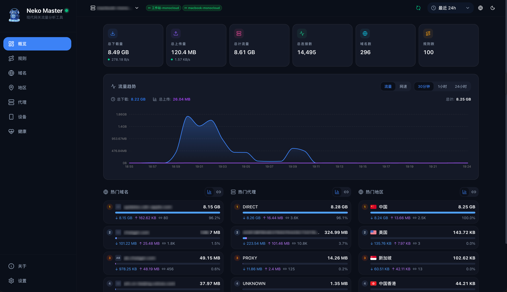

# MonoCloud → Neko Bridge

把 Linux MonoCloud / Mihomo 和 macOS MonoProxy 的流量接入 [Neko Master](https://github.com/foru17/neko-master)，复用官方 neko-agent 完成增量计算、重试与上报。

## 效果预览



## 组件

- **Linux bridge**：将现有 Mihomo Unix socket 转为带 Bearer 鉴权的本机只读 HTTP 接口。
- **macOS adapter**：订阅 MonoProxy 本地 socket，转换为 Agent 可读的连接快照，并短暂保留关闭记录。
- **官方 Agent**：每台设备独立安装、使用独立 backend/token，连接同一个 Master。

运行时只依赖 Python 标准库。当前安装脚本固定官方 Agent `agent-v1.4.8`，接口核对基于 Master `v1.4.3`；升级前核对上游兼容要求。Mac IPC 已针对 MonoProxy `1.3.0` 验证，不是官方稳定 API。

## 开始使用

先准备可访问的 Master、独立 Agent backend 和已运行的代理客户端，然后按[统一部署运维指南](docs/operations.md)安装对应采集端。

Linux 提供 [agent.env.example](agent.env.example) 配置模板。Mac 安装器要求显式传入 Master URL，可通过受限权限文件传入管理 Bearer token，不包含任何默认私有服务器地址。

## 数据范围

- 包含引擎可见的域名、目标 IP（若上游提供）、客户端源 IP、代理/策略别名、规则和流量；不保留进程身份。
- 累计字节原样传给 Agent，避免双重求差。

## 已知限制

### 用户可见的限制

- **代理名称**：Linux 可能始终显示同一个代理（见技术边界-Linux节点映射）；Mac 上的代理名称可能显示内部标识或 `UNKNOWN`，不能保证区分实际节点（见 Mac 数据来源）。
- **Mac 目标 IP 与地区**：部分代理连接只有域名，没有目标 IP，对应的 IP 和地区可能为空。
- **Mac 连接列表**：部分连接直到关闭后才显示，列表中也可能包含已结束的连接。

### 技术边界

- **Linux 节点映射**：使用 MonoCloud 的 Mihomo 接口返回的代理/策略别名，没有读取数据库映射节点名称，因为无法准确确认已有连接使用的是否是数据库中的配置。
- **Mac 数据来源**：读取 MonoProxy 的本地 Dashboard 接口；远端 DNS 解析到的目标 IP 不在本机记录中，故无法采集。该接口非官方稳定 API。
- **采集与缓存**：Linux 定时读取连接快照；Mac 缓存最多10000条，关闭记录保留120秒，尚不支持多页快照。缓存和上报队列不持久化。
- **异常与验证范围**：格式异常、容量超限或多页快照会使对应采集失败；Mac 规则/代理接口仅提供观察子集，providers 为空。独立 UDP 覆盖未完整验证。

详细边界和排障方法见[部署运维指南](docs/operations.md)。

## 开发与验证

```sh
python3 -B -m unittest discover -s tests -v
```

测试使用合成数据和临时 socket，不依赖真实账号、节点或 Master。私有配置、日志、数据库及本地调查记录不得提交。`.gitignore` 保留配置模板并忽略真实 `agent.env` / `*.env`。

这是一项非官方互操作项目，与 MonoCloud、MonoProxy、Chute 或 Neko 上游没有隶属关系。上游 Agent 由安装脚本从官方发布下载，不包含在仓库中。

## 许可证

[MIT](LICENSE)。上游客户端与 Agent 的权利及许可证归其各自项目所有。
