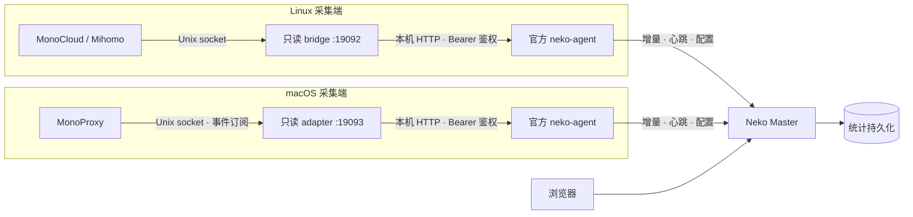

# 部署与运维指南

本指南使用通用路径与占位地址，不保存具体用户的服务器、账号或节点信息。已有部署应保留自己的私密资产清单。

## 1. 系统结构



Master 统一存储与展示。每台采集端使用独立 backend 和认证令牌。Agent上报也遵循Master URL的协议；HTTP会明文传输令牌，仅在另有加密保护的可信网络使用，否则使用HTTPS。bridge/adapter 不保存历史统计库；Agent 内存队列不能代替数据库备份。

## 2. Master 前置准备

Master 与 Agent 都按上游项目部署，本仓库只负责采集端。推荐顺序：**部署 Master → 在 Master 上创建 backend → 部署采集端 → 安装 Agent**。Agent 需要采集端的网关地址与令牌，因此应最后安装。

按 [Neko Master 官方项目](https://github.com/foru17/neko-master)部署中心服务。本仓库不安装或升级 Master，也不假定具体主机、Docker 容器名、映射端口或存储位置。

- 配置持久化存储、管理界面/API认证和适当的访问范围。
- Agent backend token 只认证该接入的上报，不能替代管理 API 认证。
- 管理 API 需要认证时，Mac 安装器支持 `--admin-token-file`，文件内容为 Master 接受的管理 Bearer token，权限必须为0600；令牌不要放入命令行参数或URL。
- 本机网关固定为loopback，但不意味着远端Master也只对本机开放。上线前检查实际认证、网络暴露和防火墙/ACL。
- 按实际部署方式备份数据库和部署配置；没有一致性在线备份方式时，在维护窗口停止Master后备份完整数据卷，再恢复运行。升级回滚应同时考虑镜像和数据库版本。

## 3. Linux 安装与服务

要求：Linux amd64、`/usr/bin/python3` 版本3.9或以上、可用的用户级systemd，以及当前用户能够读取的 Mihomo API socket。

默认socket为 `~/.Monocloud/monocloud-core-api.sock`，网关为 `http://127.0.0.1:19092`。若客户端路径不同，需要调整 `linux/bridge.py` 的入口配置后安装。

在Linux采集用户终端、仓库根目录执行：

```sh
install -d -m 700 "$HOME/.config/monocloud-neko-bridge"
install -m 600 agent.env.example "$HOME/.config/monocloud-neko-bridge/agent.env"
```

用本机编辑器填入实际 Master URL、backend ID、该backend令牌和独立随机网关令牌。模板中的 `example.invalid` 和 `replace-with-...` 不是可用配置。然后部署采集端：

```sh
python3 -B deploy/install-linux.py
systemctl --user daemon-reload
systemctl --user enable --now monocloud-neko-bridge.service
```

安装器只部署 bridge 与一个用户级 service，并打印一条从该私有配置读取凭据的官方 Agent 安装命令。它不下载或保存 `neko-agent`；Agent 的安装、常驻和升级按[上游安装指南](https://github.com/foru17/neko-master/blob/main/docs/agent/install.md)执行。可加 `--install-agent` 让安装器直接运行该命令；这会从上游仓库下载脚本并以当前用户执行，令牌经环境变量传给该脚本及其子进程，执行即表示信任上游脚本与 GitHub TLS 链路。上游在 Linux 上的 systemd 自启是系统级、需要 root；不使用 root 时可用 `nekoagent start backend-<id>` 运行，但不会随开机启动。命令中的 `NEKO_AGENT_CONFIG_DIR` 与 `NEKO_AGENT_STATE_DIR` 是 `nekoagent` 的运行时变量，请一并加入 shell profile，否则后续 `nekoagent` 命令会回到系统默认目录。

安装器在发布文件前校验配置、`/usr/bin/python3` 与 service。私有目录中保留0600安装记录；新安装中途失败后用 `python3 -B deploy/install-linux.py --repair` 恢复已记录的操作，不覆盖冲突文件。Linux恢复时允许修正私有配置。错误只输出固定错误码，不输出令牌与远端正文。不修改既有代理客户端。

| 文件 | 位置 |
|---|---|
| 运行程序 | `~/.local/lib/monocloud-neko-bridge/`（仅 `bridge.py`） |
| 私有配置 | `~/.config/monocloud-neko-bridge/agent.env` |
| 用户service | `~/.config/systemd/user/monocloud-neko-bridge.service` |

日常操作：

```sh
systemctl --user is-active monocloud-neko-bridge.service
systemctl --user restart monocloud-neko-bridge.service
systemctl --user stop monocloud-neko-bridge.service
journalctl --user -u monocloud-neko-bridge.service -n 40 --no-pager
ss -lnt | rg ':19092 '
nekoagent status backend-1   # Agent 状态，实例名以安装时为准
```

修改service后先daemon-reload。bridge监听就绪后通知systemd；Agent 由上游工具管理，首次启动前确认 bridge 已监听。需要退出登录后继续运行时，根据主机策略配置用户linger；客户端必须运行并创建socket。

## 4. macOS 安装与服务

要求：macOS arm64、持久可用的Python 3，以及正在运行的MonoProxy。默认socket为 `~/MonoProxy/Tmp/db.connect`，网关为 `http://127.0.0.1:19093`。

使用实际中心地址替换占位地址：

```sh
python3 -B deploy/install-mac.py \
  --master-url https://neko.example.invalid \
  --backend-name monocloud-mac \
  --admin-token-file /path/to/management.secret \
  --python /path/to/persistent/python3
```

管理令牌文件应置于私有目录并chmod0600。只有Master确实不要求认证时才省略此参数。非回环HTTP默认拒绝；在已经确认由独立加密通道保护的可信网络上使用HTTP，需显式加 `--allow-insecure-http`，否则使用HTTPS。不要将管理令牌嵌入URL。

安装器先校验本地目标、Python 与 plist，再创建独立backend并原子发布配置、程序和 bridge 的 LaunchAgent，不自动加载作业；它不再下载或保存 `neko-agent`。安装完成后按输出的官方 Agent 安装命令执行（或安装时加 `--install-agent`）。该命令会从上游仓库下载脚本并以当前用户执行，令牌经环境变量传递。上游在 macOS 使用 `~/Library/LaunchAgents`，保持非 root。命令中的 `NEKO_AGENT_CONFIG_DIR` 与 `NEKO_AGENT_STATE_DIR` 是 `nekoagent` 的运行时变量，请一并加入 shell profile，否则后续 `nekoagent` 命令会找不到实例。

私有配置目录中的0600 `install-state.json` 保存安装意图、backend/gateway令牌及已发布文件校验值；不要删除或公开它。失败后修正网络/权限问题，用相同参数加 `--repair` 重跑；若尚未尝试创建backend、且没有发布任何文件，可以在 `--repair` 时修正Master地址、backend名称或Python路径。尝试创建后这些参数固定，防止遗失远端归属。仅接受该次安装记录匹配的远端backend和本地文件，不接管其他同名backend。创建响应丢失时，通过唯一安装标识核对已创建backend，继续使用原令牌。该功能不升级旧安装；旧版本没有安装记录时仍拒绝覆盖。

| 文件 | 位置 |
|---|---|
| 运行程序 | `~/.local/lib/monocloud-neko-bridge-mac/`（adapter、protocol、launcher、bridge） |
| 私有配置 | `~/.config/monocloud-neko-bridge-mac/agent.env` |
| plist | `~/Library/LaunchAgents/io.monocloud-neko.bridge.plist` |
| 运行日志 | `~/.local/state/monocloud-neko-bridge-mac/` |

加载与查看：

```sh
launchctl bootstrap "gui/$(id -u)" ~/Library/LaunchAgents/io.monocloud-neko.bridge.plist
launchctl print "gui/$(id -u)/io.monocloud-neko.bridge"
lsof -nP -iTCP:19093 -sTCP:LISTEN
nekoagent status backend-1
```

重启与停止采集端：

```sh
launchctl kill SIGTERM "gui/$(id -u)/io.monocloud-neko.bridge"
launchctl bootout "gui/$(id -u)/io.monocloud-neko.bridge"
```

Agent 的重启、停止与卸载使用上游命令：`nekoagent restart|stop|remove <instance>`。

启动器先向仍在运行的主进程组转发终止信号，超过15秒则强制结束。若主进程已经退出、但后代仍持有日志管道，最多读取15秒尾部日志后退出；不会对已回收的进程组ID发信号，也不保证回收自行派生的后台后代。KeepAlive重新拉起作业，受launchd节流影响可能等待约10秒。作业PID只证明启动器存在，还需检查采集接口与上报状态。

刚bootout后立即bootstrap可能因注销未完成报错误5，先确认状态、等待后重试，不要改用root加载。LaunchAgent只在此用户登录会话运行，客户端也需运行。

`bridge.log`各按约1MiB轮转，最多保留2个旧副本。`bridge-launch.log`接收启动器自身错误；持续启动失败时先修复原因，再停作业清理诊断文件。Agent 日志使用 `nekoagent logs <instance>`。

Mac IPC 的默认握手值是MonoProxy 1.3.0应用内置常量，不是账号凭证。兼容版本需要不同值时，可在私有配置中设置 `MONOPROXY_LOCAL_PASSWORD`，不要修改公开源码写入用户秘密。

## 5. 健康检查与排障

使用私有配置中的 `NEKO_GATEWAY_TOKEN` 作为Bearer访问本机 `/health`、`/connections`，不要在终端打印真实连接详情或令牌。Master状态从已登录的管理页面查看。两端网关401表示本机令牌错误，不能用管理token替代。

| 现象 | 检查范围 |
|---|---|
| 所有接入无法上报且网页不可达 | Master网络、服务与实际监听端口 |
| 只有一个接入没有新流量 | 对应客户端、socket、bridge/adapter和Agent |
| Master healthy但无新数据 | 心跳不等同于采集成功；检查本机接口与collector/report错误，以及时间筛选和批量落库延迟 |
| Linux503 | 首次成功采集前状态为starting；之后检查socket缺失、权限、上游连接失败或超时；响应超限也明确返回503 |
| Linux502 | 上游非200、结构异常或响应超出16MiB |
| Mac partial_snapshot / cache_capacity / counter_regressed | 分页未完成（当前不支持续页，若客户端返回多页则停止上报）、缓存达到上限或计数回退；原始原因保留在健康/日志中 |
| Mac dashboard_unavailable | 客户端或socket断开、格式/协议变化或单帧超过16MiB；日志记录异常类型，不记录报文正文 |
| Mac response_limit | 输出超过16MiB；接口返回503，日志记录response_limit，采集器本身可能仍healthy |
| Mac缺少目标IP/地区 | 原记录可能跳过本地DNS；保留空值，不使用代理IP替代 |
| Mac代理显示内部别名或UNKNOWN | 上游别名不透明或没有提供路由信息；UNKNOWN不是实际节点 |

Linux `/health` 是最近一次读取结果，不是持续探测。Mac默认每10秒完整同步，超过30秒未确认则降级；自定义同步间隔时阈值至少为间隔的3倍。错误显式返回502/503，不伪造零连接。

## 6. 数据口径与限制

- 只统计客户端引擎可见流量，无进程身份，不代表整机流量。上报可包含客户端源IP，可能识别局域网设备，部署者应据此设置访问与留存权限。
- bridge保留累计计数，Agent求增量。引擎字节不等于应用有效载荷，连接数采用Neko的聚合口径。
- Linux快照可能漏采短连接及末尾字节。
- Mac先暂存未就绪元数据，信息齐全或真实关闭后才暴露；部分连接在关闭后才显示。关闭记录在 `/connections` 中保留120秒，供Agent读取最终值，该接口不能简单当作实时活动连接列表。
- Mac缓存最多10000项（含关闭保留记录），达到上限会明确降级；尚未实现独立容量配额或主动丢弃终结记录。
- Mac规则/代理接口只反映观察子集，providers为空，不等于完整客户端配置。
- 目标IP缺失时留空，不另做DNS猜测、不把代理IP当作目标地址。地区是目标IP归属，不是节点所在国。
- 缓存及上报队列在内存中，客户端引擎重启、休眠、崩溃或长断线可能丢数据，不能宣称完整字节审计。独立UDP覆盖未完整验证。
- 单条不合法记录目前会使该次采集失败，而不是静默跳行；客户端升级后需先验证协议兼容。
- Agent令牌通过原版命令行参数传入，具有相应进程查看权限的本机账户可能读取；私有配置及备份须限制权限。
- Master 位于局域网时，Agent 连接 Master 本身可能触发 macOS 的本地网络授权；这与 bridge 的回环监听无关，按需授权即可。

## 7. 备份、升级与卸载

Master：备份实际数据卷及部署配置，升级与数据库回滚按上游要求处理。保留时长与备份周期由部署者按容量与恢复目标配置，本仓库不强制默认策略。

采集端：备份对应专用程序、私有配置及service/plist。升级在目标版本仓库中运行 `python3 -B deploy/upgrade.py`：自动检查配置必填项、备份、只替换变化的文件、重启采集端并检查 `/health`，失败时自动回滚；备份位于 `~/.local/state/monocloud-neko-upgrade/`。脚本只处理存在 `install-state.json` 的安装；旧安装可按[升级指南](upgrade.md)用 `--adopt` 接管（不校验已装文件），或重新安装。Agent 的升级使用上游 `nekoagent upgrade`，它与本脚本互不管理；旧版本安装的 Agent unit/plist 以及 `run_agent.py`、`neko-agent`、`release.txt` 按升级指南迁移后删除。

Linux卸载前：

```sh
systemctl --user disable --now monocloud-neko-bridge.service
```

再按需删除Linux专用程序、配置及service并daemon-reload。Mac先bootout `io.monocloud-neko.bridge`，再移除对应plist，防止下次登录启动，按需删除专用程序、配置及日志。Agent 使用 `nekoagent remove <instance>` 与 `nekoagent uninstall` 卸载。不要删除客户端账号数据、其他Agent或其他backend。

停用采集端不会删除Master历史数据；删除backend与清理统计应单独决定。不要批量删除其他服务的journal。


安装记录与私有配置一起备份；它含令牌，不应进入Git或公开诊断文件。完成安装不会自动提交、推送或启动服务。
